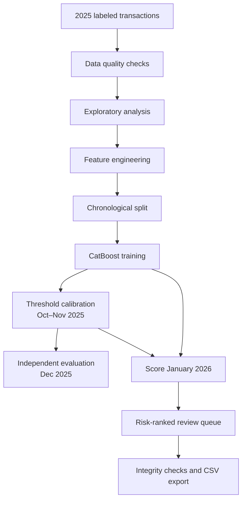

<div align="center">

# AI Fraud Sentinel

**A practical machine learning workflow to identify suspicious transactions and prioritize fraud review.**

[](https://www.python.org/)
[](https://catboost.ai/)
[](https://scikit-learn.org/)
[](https://jupyter.org/)
[](#)

*From historical transaction data to a risk-ranked review queue.*

[Notebook](AI_Fraud_Sentinel_EN.ipynb) · [Presentation (PDF)](AI_Fraud_Sentinel_EN.pdf) · [Português](README.pt-BR.md)

</div>

---

## Overview

AI Fraud Sentinel explores how machine learning can support a fraud-prevention workflow that relies heavily on manual transaction reviews. The project uses labeled transaction history from 2025 to train and evaluate a binary classifier, then applies the model to unlabeled transactions from January 2026.

The goal is not to automatically declare a transaction fraudulent. It is to estimate risk consistently, organize the review queue, and give analysts useful signals for deciding where to look first.

## At a glance

| | Reference result |
|---|---:|
| Historical transactions (2025) | **523,525** |
| Labeled fraud cases | **20,485 (3.91%)** |
| Independent test period | **December 2025** |
| ROC-AUC | **0.910** |
| Average Precision | **0.609** |
| Precision / Recall | **62.8% / 57.6%** |
| F1-score | **0.601** |
| January 2026 transactions scored | **44,451** |
| January transactions flagged for review | **2,122 (4.78%)** |

> **Important:** The metrics above were measured on the December 2025 holdout set, which contains fraud labels. January 2026 has no ground-truth fraud labels. Its 2,122 flagged transactions are model-generated alerts for review, not confirmed fraud cases.

## The data

The case provides two transaction datasets:

| Dataset | Records | Columns | Role |
|---|---:|---:|---|
| `transacoes_historico_2025.csv` | 523,525 | 15 | Labeled history used for exploration, training, calibration, and testing |
| `transacoes_jan2026.csv` | 44,451 | 14 | Unlabeled records scored after model development |

The historical target is `flag_fraude`. It is not present in the January dataset, so the model cannot be evaluated against confirmed January outcomes.

The notebook includes integrity checks for row counts, missing values, duplicate rows, invalid timestamps, date ranges, and column compatibility. In the supplied reference run, both datasets had no missing values, no complete duplicate rows, and no invalid timestamps. The January output preserves all 44,451 original records and all 14 original columns, then adds three prediction fields.

## Methodology

The workflow follows the order in which a fraud model would be developed and assessed in practice:



### 1. Data preparation and feature engineering

- Convert `datahora_transacao` into hour, day of week, day of month, month, and weekend indicators.
- Keep categorical transaction attributes available to CatBoost.
- Exclude `nome_cliente` and `codigo_postal` from model inputs to reduce the risk of memorizing high-cardinality identifiers.
- Work on copies of the original DataFrames so source records are not modified.

### 2. Time-based validation

Transactions are split chronologically rather than randomly. This better reflects the intended use: learn from past activity and score a later period.

| Period | Purpose | Records |
|---|---|---:|
| January–September 2025 | Model training | 391,566 |
| October–November 2025 | Threshold calibration | 87,508 |
| December 2025 | Independent final test | 44,451 |

December is kept out of both model fitting and threshold selection. This provides a more realistic check of performance on a subsequent period.

### 3. Model and decision threshold

The classifier is **CatBoost**, a gradient-boosted decision-tree model with native support for categorical features. Training uses early stopping based on the calibration period.

The decision threshold is selected by maximizing F1 on the October–November calibration data. The reference threshold is approximately **0.293**. This is an initial trade-off between precision and recall, not a permanent business rule. The high-risk band uses an additional illustrative cutoff of **0.60**.

### 4. December 2025 evaluation

| Metric | Result |
|---|---:|
| ROC-AUC | **0.910** |
| Average Precision | **0.609** |
| Precision | **62.8%** |
| Recall | **57.6%** |
| F1-score | **0.601** |

Precision and recall should be read together. Precision describes how many flagged transactions were fraud in the test set; recall describes how many known fraud cases were identified. Average Precision is especially useful when the target is imbalanced, as it is here.

## January 2026 scoring results

The model scored every January transaction and assigned a review category:

| Risk level | Score rule | Transactions |
|---|---|---:|
| High | Score ≥ 0.60 | **1,025** |
| Attention / review | Calibrated threshold ≤ score < 0.60 | **1,097** |
| Low | Score < calibrated threshold | **42,329** |
| **Total** | | **44,451** |

A total of **2,122 transactions (4.78%)** were flagged for review. These categories are prioritization signals only. Since the January file has no confirmed labels, it is not possible to calculate January precision, recall, F1, or accuracy.

### Output fields

The generated `transacoes_jan2026_classificadas.csv` retains the original January columns and adds:

| Field | Description |
|---|---|
| `score_risco_fraude` | Model risk score between 0 and 1. It should not be interpreted as a calibrated probability. |
| `flag_fraude_prevista` | Binary flag based on the threshold selected during calibration. |
| `nivel_risco` | Review priority: `Alto`, `Atenção`, or `Baixo`. |

## Key observations

- Fraud represented **3.91%** of labeled transactions in the 2025 history, so accuracy alone would not be a reliable measure of model quality.
- The observed fraud rate was **12.9% for new devices** and **2.1% for known devices**. This is an association in the supplied data, not evidence that a new device causes fraud.
- Transaction hour had the greatest relative feature importance in the reference model (**49.5%**). That unusually strong temporal signal deserves business review and monitoring before it is used in operational rules.

## Responsible use and current limitations

- **Human review first:** alerts should support analysts. The project does not recommend automatically blocking customers based only on the model score.
- **No January ground truth:** January classifications are predictions, not confirmed outcomes. Performance on that month cannot yet be measured.
- **Score interpretation:** the score is a model output, not a calibrated probability of fraud.
- **Threshold trade-offs:** the selected threshold maximizes F1 because the case does not provide the business cost of false positives and false negatives. Operational thresholds should be agreed with the fraud team.
- **Temporal patterns:** the high importance of transaction hour should be investigated for data-generation artifacts, leakage, seasonality, and distribution changes.
- **Monitoring:** a production system would need ongoing checks for data drift, model performance, alert volumes, and customer impact.

## Repository structure

```text
AI-Fraud-Sentinel/
├── AI_Fraud_Sentinel_EN.ipynb              # End-to-end analysis and modeling
├── AI_Fraud_Sentinel_EN.pdf                 # Presentation version
├── AI_Fraud_Sentinel_EN.pptx                # Editable presentation
├── transacoes_historico_2025.csv            # Labeled historical dataset
├── transacoes_jan2026.csv                   # Unlabeled January dataset
├── transacoes_jan2026_classificadas.csv     # Reference scoring output
├── modelo_catboost_fraude.cbm               # Reference trained model
├── requirements.txt                         # Python dependencies
└── README.md                                # Project documentation
```

## Run locally

### Requirements

- Python 3.10 or later
- Jupyter Notebook
- The Python packages listed in `requirements.txt`
- Both original CSV files in the same directory as the notebook

### 1. Clone the repository

```bash
git clone <YOUR_REPOSITORY_URL>
cd AI-Fraud-Sentinel
```

### 2. Create and activate a virtual environment

**Windows (PowerShell):**

```powershell
python -m venv .venv
.venv\Scripts\Activate.ps1
```

**macOS / Linux:**

```bash
python3 -m venv .venv
source .venv/bin/activate
```

### 3. Install dependencies

```bash
python -m pip install --upgrade pip
python -m pip install -r requirements.txt
```

### 4. Launch Jupyter

```bash
python -m notebook
```

Open `AI_Fraud_Sentinel_EN.ipynb` and run the cells from top to bottom, or use **Run → Run All**. The notebook trains the model, saves `modelo_catboost_fraude.cbm`, scores the January dataset, writes `transacoes_jan2026_classificadas.csv`, and checks that the output retains all 44,451 input records.

> The bundled model and classified CSV are reference artifacts from the completed run. Re-running the notebook retrains the model and regenerates the output. Small differences may occur across software versions and environments.

## Tech stack

- **Python** — project implementation
- **Pandas / NumPy** — data loading, validation, and feature preparation
- **CatBoost** — binary classification
- **scikit-learn** — evaluation metrics and threshold selection
- **Matplotlib** — exploratory analysis and model evaluation charts
- **Jupyter Notebook** — reproducible, documented workflow

## Data privacy and sharing

The transaction files were supplied for this case study. Before publishing a repository that contains the CSV files, confirm that redistribution is explicitly permitted and that the data is approved for public sharing. Pseudonymized identifiers do not, by themselves, guarantee that a transaction dataset is safe to publish. When permission is unclear, keep the data out of the public repository and document how an authorized reviewer can obtain it.

---

<div align="center">

**AI Fraud Sentinel** · A case study in imbalanced classification, temporal validation, and responsible fraud-risk prioritization.

</div>
