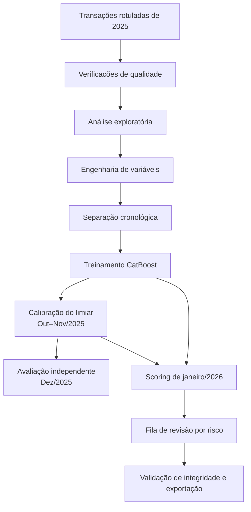

<div align="center">

# AI Fraud Sentinel

**Um fluxo de Machine Learning para identificar transações suspeitas e priorizar análises de fraude.**

[](https://www.python.org/)
[](https://catboost.ai/)
[](https://scikit-learn.org/)
[](https://jupyter.org/)
[](#)

*Do histórico de transações a uma fila de análise organizada por risco.*

[Notebook](AI_Fraud_Sentinel_PT.ipynb) · [Apresentação (PDF)](AI_Fraud_Sentinel_PT.pdf) · [English](README.md)

</div>

---

## Visão geral

O AI Fraud Sentinel explora como Machine Learning pode apoiar um processo de prevenção a fraudes que depende de análises manuais de transações. O projeto utiliza o histórico rotulado de 2025 para treinar e avaliar um classificador binário e, em seguida, aplica o modelo às transações sem rótulo de janeiro de 2026.

A proposta não é declarar automaticamente que uma transação é fraudulenta. O objetivo é estimar o risco de forma consistente, organizar a fila de revisão e oferecer sinais úteis para ajudar a equipe a decidir por onde começar.

## Resultados em resumo

| | Resultado de referência |
|---|---:|
| Transações históricas (2025) | **523.525** |
| Fraudes rotuladas | **20.485 (3,91%)** |
| Período de teste independente | **Dezembro de 2025** |
| ROC-AUC | **0,910** |
| Average Precision | **0,609** |
| Precisão / Recall | **62,8% / 57,6%** |
| F1-score | **0,601** |
| Transações de janeiro/2026 analisadas | **44.451** |
| Transações sinalizadas para revisão | **2.122 (4,78%)** |

> **Importante:** as métricas acima foram calculadas no conjunto de teste de dezembro/2025, que possui rótulos de fraude. Janeiro/2026 não contém rótulos reais. Portanto, as 2.122 transações sinalizadas são alertas gerados pelo modelo para revisão, e não fraudes confirmadas.

## Os dados

O case fornece duas bases de transações:

| Base | Registros | Colunas | Utilização |
|---|---:|---:|---|
| `transacoes_historico_2025.csv` | 523.525 | 15 | Histórico rotulado para análise, treinamento, calibração e teste |
| `transacoes_jan2026.csv` | 44.451 | 14 | Registros sem rótulo, utilizados após o desenvolvimento do modelo |

A variável-alvo do histórico é `flag_fraude`. Ela não existe na base de janeiro; por isso, não é possível comparar as previsões desse mês com resultados reais de fraude.

O notebook realiza verificações de quantidade de linhas, valores ausentes, duplicidades, timestamps inválidos, intervalo de datas e compatibilidade das colunas. Na execução de referência, as duas bases não apresentaram valores ausentes, linhas completamente duplicadas ou timestamps inválidos. O resultado de janeiro preserva os 44.451 registros e as 14 colunas originais, adicionando três campos de previsão.

## Metodologia

O fluxo segue a sequência de desenvolvimento e avaliação de um modelo de fraude:



### 1. Preparação dos dados e criação de variáveis

- A coluna `datahora_transacao` é transformada em hora, dia da semana, dia do mês, mês e indicador de fim de semana.
- Os atributos categóricos das transações são mantidos para uso pelo CatBoost.
- `nome_cliente` e `codigo_postal` são excluídos das entradas do modelo para reduzir o risco de memorização de identificadores com alta cardinalidade.
- As transformações são feitas em cópias dos DataFrames, sem alterar os arquivos originais.

### 2. Separação temporal

As transações são divididas cronologicamente, em vez de serem embaralhadas aleatoriamente. Assim, a avaliação se aproxima do uso pretendido: aprender com o passado e analisar um período posterior.

| Período | Finalidade | Registros |
|---|---|---:|
| Janeiro–setembro/2025 | Treinamento do modelo | 391.566 |
| Outubro–novembro/2025 | Calibração do limiar | 87.508 |
| Dezembro/2025 | Teste final independente | 44.451 |

Dezembro não participa do treinamento nem da escolha do limiar, permitindo avaliar o modelo em um mês posterior.

### 3. Modelo e limiar de decisão

O classificador utilizado é o **CatBoost**, algoritmo de gradient boosting baseado em árvores de decisão e com suporte nativo a variáveis categóricas. O treinamento utiliza *early stopping* com base no período de calibração.

O limiar de decisão é escolhido pela maximização do F1 na base de outubro e novembro. Na execução de referência, o valor ficou próximo de **0,293**. Esse é um ponto inicial de equilíbrio entre precisão e recall, não uma regra definitiva de negócio. A faixa de alto risco utiliza um segundo limite ilustrativo de **0,60**.

### 4. Avaliação em dezembro/2025

| Métrica | Resultado |
|---|---:|
| ROC-AUC | **0,910** |
| Average Precision | **0,609** |
| Precisão | **62,8%** |
| Recall | **57,6%** |
| F1-score | **0,601** |

Precisão e recall devem ser interpretados em conjunto. A precisão indica quantas transações sinalizadas eram fraudes no teste; o recall indica quantas das fraudes conhecidas foram identificadas. A Average Precision também é relevante porque a variável-alvo é desbalanceada.

## Resultado da classificação de janeiro/2026

O modelo calculou um score para todas as transações de janeiro e atribuiu uma faixa de prioridade:

| Nível de risco | Regra de score | Transações |
|---|---|---:|
| Alto | Score ≥ 0,60 | **1.025** |
| Atenção / revisão | Limiar calibrado ≤ score < 0,60 | **1.097** |
| Baixo | Score < limiar calibrado | **42.329** |
| **Total** | | **44.451** |

Ao todo, **2.122 transações (4,78%)** foram sinalizadas para revisão. Essas categorias servem para priorização. Como a base de janeiro não possui rótulos confirmados, não é possível calcular precisão, recall, F1 ou acurácia para esse mês.

### Campos adicionados ao resultado

O arquivo `transacoes_jan2026_classificadas.csv` mantém as colunas originais de janeiro e adiciona:

| Campo | Descrição |
|---|---|
| `score_risco_fraude` | Score de risco calculado pelo modelo, entre 0 e 1. Não deve ser interpretado como probabilidade calibrada. |
| `flag_fraude_prevista` | Sinalização binária baseada no limiar selecionado durante a calibração. |
| `nivel_risco` | Prioridade de revisão: `Alto`, `Atenção` ou `Baixo`. |

## Principais observações

- As fraudes representaram **3,91%** das transações rotuladas no histórico de 2025. Por isso, a acurácia isolada não seria suficiente para avaliar o modelo.
- A taxa histórica observada foi de **12,9% em dispositivos novos** e **2,1% em dispositivos conhecidos**. Essa é uma associação encontrada na base, não uma evidência de que um dispositivo novo cause fraude.
- A hora da transação apresentou a maior importância relativa no modelo de referência (**49,5%**). Esse sinal temporal, bastante forte, merece avaliação e monitoramento antes de orientar regras operacionais.

## Uso responsável e limitações

- **Revisão humana:** os alertas devem apoiar a análise da equipe. O projeto não recomenda bloquear clientes automaticamente com base apenas no score.
- **Ausência de rótulos em janeiro:** as classificações são previsões, não resultados confirmados. Ainda não é possível medir o desempenho do modelo nesse mês.
- **Interpretação do score:** o valor representa uma saída do modelo e não uma probabilidade calibrada de fraude.
- **Escolha do limiar:** o limiar foi definido pelo F1 porque o case não informa o custo de falsos positivos e falsos negativos. A área de prevenção a fraudes deve validar os trade-offs antes de qualquer uso operacional.
- **Padrões temporais:** a alta importância da hora precisa ser investigada para identificar possíveis artefatos de geração dos dados, vazamento de informação, sazonalidade e mudanças de distribuição.
- **Monitoramento:** uma solução em produção exigiria acompanhamento contínuo de mudanças nos dados, desempenho, volume de alertas e impacto na experiência dos clientes.

## Estrutura do repositório

```text
AI-Fraud-Sentinel/
├── AI_Fraud_Sentinel_PT.ipynb              # Análise e modelagem ponta a ponta
├── AI_Fraud_Sentinel_PT.pdf                 # Apresentação em PDF
├── AI_Fraud_Sentinel_PT.pptx                # Apresentação editável
├── transacoes_historico_2025.csv            # Histórico rotulado
├── transacoes_jan2026.csv                   # Base de janeiro sem rótulos
├── transacoes_jan2026_classificadas.csv     # Resultado de referência
├── modelo_catboost_fraude.cbm               # Modelo treinado de referência
├── requirements.txt                         # Dependências Python
└── README.md                                # Documentação do projeto
```

## Como executar localmente

### Pré-requisitos

- Python 3.10 ou superior
- Jupyter Notebook
- Bibliotecas Python listadas em `requirements.txt`
- Os dois arquivos CSV originais na mesma pasta do notebook

### 1. Clone o repositório

```bash
git clone <URL_DO_SEU_REPOSITORIO>
cd AI-Fraud-Sentinel
```

### 2. Crie e ative um ambiente virtual

**Windows (PowerShell):**

```powershell
python -m venv .venv
.venv\Scripts\Activate.ps1
```

**macOS / Linux:**

```bash
python3 -m venv .venv
source .venv/bin/activate
```

### 3. Instale as dependências

```bash
python -m pip install --upgrade pip
python -m pip install -r requirements.txt
```

### 4. Abra o Jupyter

```bash
python -m notebook
```

Abra `AI_Fraud_Sentinel_PT.ipynb` e execute as células de cima para baixo ou selecione **Run → Run All**. O notebook treina o modelo, salva `modelo_catboost_fraude.cbm`, calcula os scores de janeiro, gera `transacoes_jan2026_classificadas.csv` e verifica se os 44.451 registros da entrada foram preservados.

> O modelo e o CSV classificado incluídos no pacote são resultados de referência da execução concluída. Ao executar o notebook novamente, o modelo é treinado e o arquivo de saída é regenerado. Pequenas diferenças podem ocorrer entre versões de bibliotecas e ambientes.

## Tecnologias

- **Python** — implementação do projeto
- **Pandas / NumPy** — leitura, validação e preparação dos dados
- **CatBoost** — classificação binária
- **scikit-learn** — métricas de avaliação e seleção do limiar
- **Matplotlib** — gráficos exploratórios e de avaliação
- **Jupyter Notebook** — fluxo documentado e reproduzível

## Privacidade e compartilhamento dos dados

Os arquivos de transações foram fornecidos para este estudo de caso. Antes de publicar um repositório que contenha os CSVs, confirme se a redistribuição está expressamente autorizada e se os dados foram aprovados para divulgação pública. Identificadores pseudonimizados, por si só, não garantem que uma base transacional seja segura para publicação. Se houver dúvida sobre a autorização, mantenha os dados fora do repositório público e documente como uma pessoa autorizada pode obtê-los.

---

<div align="center">

**AI Fraud Sentinel** · Um estudo de caso sobre classificação desbalanceada, validação temporal e priorização responsável de risco de fraude.

</div>
